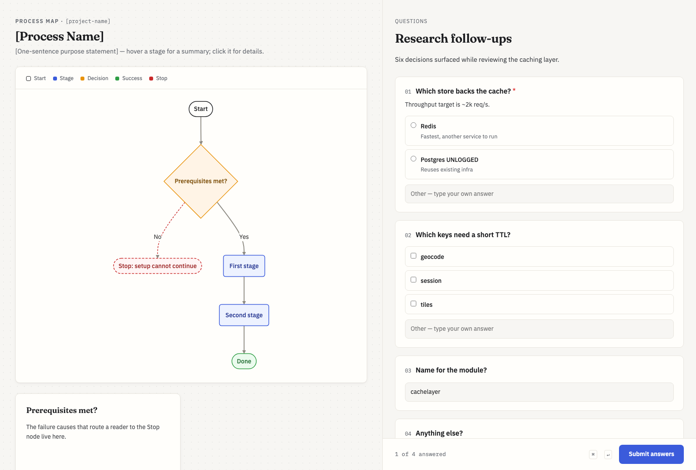

# interactive-html

The questions live inside the HTML Claude is already producing — radio boxes, checkboxes, free-text fields — served on localhost. You fill it in, hit Submit, and the answers land back in the session automatically. No returning to the terminal to type out which answer went with which question.



## When it fires

Claude Code's built-in `AskUserQuestion` already covers up to 4 questions with 2–4 options each, so this skill is scoped to where that runs out:

- more than four questions at once
- answers that need free text, not a pick from a short list
- questions that only make sense next to the document they're about

Model-invoked on those conditions, and `/interactive-html` when you want to force it.

## Two layouts

Chosen by the shape of the material, not the number of questions:

- **Panel** (above) — one document, several questions about it as a whole. The file renders in a left pane, questions beside it.
- **Inline** — questions each attached to a different part of the material. `prose` blocks and questions interleave in one column, so each question sits under the thing it asks about. A section-by-section review wants this.

## How the answers get back

A local HTTP server, and the exit is the signal:

```
python3 form.py spec.json answers.json   (background)
      |
      +-- prints  FORM READY http://127.0.0.1:PORT/
      |
   [ you fill it in, click Submit ]
      |
      +-- POST /submit -> answers.json written -> server exits
                              |
                     exit re-invokes Claude, which reads the file
```

Claude never polls and never blocks — the background process ending *is* the notification. Waits indefinitely by default; `--timeout-min N` adds a deadline (exit code 2).

## Spec format

`spec.json` drives the render, so Claude writes a small JSON file rather than bespoke HTML each time. Full schema lives in the [`form.py`](form.py) docstring. Question types: `choice` (radios), `multi` (checkboxes), `text`, `longtext`, and `prose` (a document block with no input). `choice` and `multi` always carry an "Other" free-text box, so you're never boxed into the options offered — and Other wins if it contradicts a ticked option.

## Notes

- Stdlib Python only, no dependencies. Binds to `127.0.0.1` on an ephemeral port.
- `document` takes an HTML file. Markdown isn't converted — deliberate, to stay dependency-free; Claude renders to HTML first.
- Matches the "engineering paper" design system used by [flowchart](../flowchart/), light and dark.
- ⌘↵ submits. Required questions are marked and block submit until answered.
